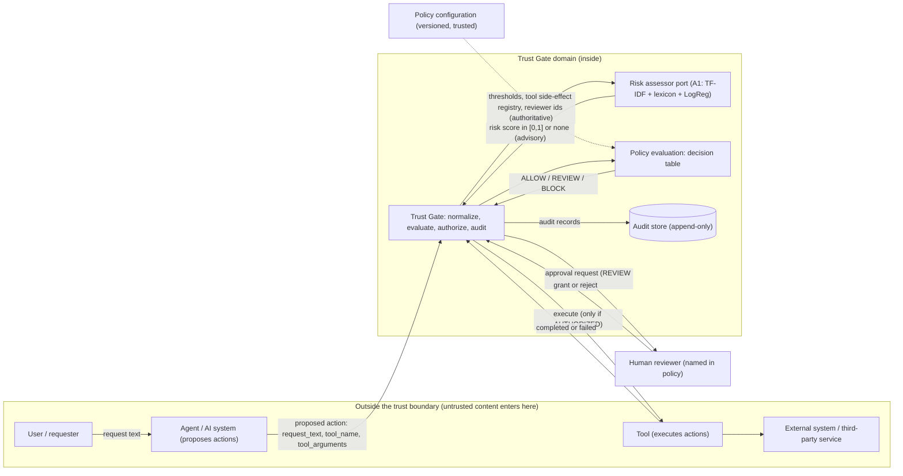

# Context map and domain boundary

Labels: **A1** = supported by A1 files; **A2** = A2 design decision (see `a1_baseline.md` C-1..C-4).

## 1. Diagram

Direction of dependency: the Trust Gate depends on abstractions (`RiskAssessor`, `ToolExecutor`, `AuditStore`, `Clock` in
`src/trustgate/ports.py`); adapters depend on the domain, never the reverse (checked by
`tests/test_model_consistency.py::test_domain_modules_import_only_stdlib_or_the_domain_itself`).

Relationship types (DDD): Agent -> Trust Gate is *upstream/downstream with the gate as downstream conformist on the action
shape* but with an anti-corruption step (normalization + validation) before anything is trusted. Trust Gate -> Tool is
*customer/supplier* where the gate is the customer and may refuse. Policy configuration is a *shared kernel* read by the gate only.

## 2. Boundaries

| Boundary | Responsibility | Inputs | Outputs | Trusted? | Authority | Security / privacy implications |
|---|---|---|---|---|---|---|
| User / requester (outside) - A1 | Express what they want | - | request text | **Untrusted** | None over the decision | Text may be harmful or contain secrets/personal data; may contain instructions aimed at the gate (e.g. phrased to evade the lexicon, A1-FN). |
| Agent / AI system (outside) - A1 "AI/LLM" | Turn a request into a proposed action | user text | `request_text`, `tool_name`, `tool_arguments`, ids | **Untrusted** | None: cannot declare an action safe, authorized, or side-effect free | The agent may be manipulated by the user or by tool output. Any agent-supplied metadata is ignored for decisions. |
| Trust Gate (inside) - A1 (concept), A2 (structure) | Normalize, validate, obtain risk estimate, evaluate policy, issue decision, hold approval state, authorize, call tool, audit | proposed action; risk score; reviewer verdicts; tool result | decision; authorization; execution call; audit records | **Trusted** (it is the system under specification) | **Authoritative for the decision and for authorization** | Must fail closed; must not log request text (digest only). |
| Risk assessor (inside the domain as a port; adapter code is replaceable) - A1 | Estimate risk of the request text | normalized `request_text` (never `tool_arguments`) | score in [0,1] or none | **Advisory**: output is validated, not trusted | Authoritative only for *the estimate*; **not** for the decision | The A1 model never saw tool arguments (U-07). Estimate is uncalibrated (U-06). Out-of-range output is rejected (`ValidationError`). |
| Policy configuration (inside) - A2 | Hold thresholds, tool side-effect registry, reviewer ids | maintainer edits (out of scope) | immutable `PolicyConfig` with `policy_version` | **Trusted** | Authoritative for thresholds, side-effect knowledge, who may approve | Tampering changes every decision; protect and version it. Unregistered tools are `UNKNOWN`. |
| Human reviewer (outside) - A1 "non-software alternative" | Grant or reject a REVIEW action | approval request | grant / reject, `reviewer_id` | **Trusted only if listed** in policy; authentication is not modelled (U-04) | Authoritative for approval only | Reviewer sees action content: access restrictions needed in a real deployment. |
| Tool (outside) - A1 "AI system continues" | Perform the work | authorized action | success / failure | **Untrusted** for outcome | None | Failure is recorded, never trusted; real side effects are out of scope (simulated). |
| External system (outside) | Whatever the tool touches | tool calls | - | **Untrusted** | None | Not modelled; no network access in this repository. |
| Audit store (inside) - A1 weakness "not auditable", A2 | Keep an append-only record of what happened | audit records | read access | **Trusted** | **Authoritative for what happened** | Holds ids and a text SHA-256, no raw text. In-memory only in A2 (U-10). |
| A1 training pipeline (offline, outside the runtime) | Fit the A1 classifier on JBB-Behaviors | public dataset | model | Dataset integrity pinned by SHA-256 | - | Data is public; harmful rows are used as classification data only. |

## 3. Where untrusted external content enters

| # | Entry point | Field | Mitigation in the model | Remaining gap |
|---|---|---|---|---|
| E-1 | User text relayed by the agent | `request_text` | Validation (non-empty, no NUL), NFC normalization, risk scoring, never executed as code, stored only as digest in audit | Lexicon/phrasing evasion (CX-1) |
| E-2 | Agent-supplied tool name | `tool_name` | Pattern `^[a-z][a-z0-9_]{0,63}$`; side effect looked up in the registry; unknown = `UNKNOWN` | Registry completeness (U-03) |
| E-3 | Agent-supplied arguments | `tool_arguments` | Must be a mapping with non-empty string keys; **not scored**; agent claims about side effects ignored | Arguments are not risk-assessed (U-07) |
| E-4 | Agent-supplied ids | `action_id`, `request_id` | Pattern check; duplicate `action_id` rejected | - |
| E-5 | Risk assessor output | score | Range check; `None` = fail closed | Model error within range |
| E-6 | Reviewer identity claim | `reviewer_id` | Must be in the policy list | No authentication (U-04) |
| E-7 | Tool outcome | exception / success | Recorded as `ToolExecutionCompleted` / `ToolExecutionFailed`; detail not stored | - |
| E-8 | Training data (offline) | JBB CSVs | SHA-256 manifest check in A1 `prepare_data.py` | Upstream byte-identity not verified (U-13) |
