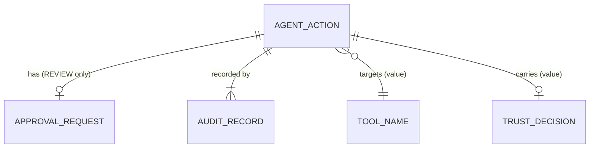

# Entities

An entity has identity and a meaningful lifecycle. Three concepts qualify; the others were considered and classified
elsewhere (section 5). Implementation: `src/trustgate/entities.py`.

## 1. AgentAction (central lifecycle entity)

| Aspect | Specification |
|---|---|
| Business meaning | One proposed unit of work evaluated by the gate. In A1 terms: a user request about to be passed to the AI system (`tool_name = llm_generate`). |
| Unique identifier | `action_id` (caller-supplied, pattern `^[A-Za-z0-9][A-Za-z0-9._:-]{0,63}$`, unique within a gate) |
| Attributes | `action_id`, `request_id`, `request_text`, `tool_name`, `tool_arguments`, `state`, `risk_score` (optional), `model_version` (optional), `decision` (optional `TrustDecision`), `authorization`, `approval` (optional), `history` (ordered `ActionEvent`s) |
| Lifecycle / state | PROPOSED -> NORMALIZED -> RISK_ASSESSED -> {ALLOWED \| PENDING_APPROVAL \| BLOCKED}; PENDING_APPROVAL -> {APPROVED \| REJECTED}; {ALLOWED \| APPROVED} -> EXECUTING -> {EXECUTED \| EXECUTION_FAILED}. See [state_model.md](state_model.md). |
| Invariants | INV-01 ... INV-06 ([invariants.md](invariants.md)) |
| Relationships | 0..1 `ApprovalRequest` (only if decision is REVIEW); 1..n `AuditRecord` (one per history event); references one tool by `tool_name`; shares `request_id` with the originating request |
| Authoritative source | The Trust Gate (state, decision, authorization). Content fields come from the untrusted agent and are only validated/normalized. |
| Ownership | Owned and mutated only by the Trust Gate through the guarded methods of `AgentAction` |
| Privacy classification | `request_text` and `tool_arguments`: **sensitive / may contain personal data** (user-originated). Everything else: internal. |

## 2. ApprovalRequest

| Aspect | Specification |
|---|---|
| Business meaning | The pending question "may this REVIEW action run?" and its outcome |
| Unique identifier | `approval_id` = `APR-<action_id>` (one per action) |
| Attributes | `approval_id`, `action_id`, `requested_at`, `status`, `reviewer_id` (optional), `decided_at` (optional) |
| Lifecycle / state | `PENDING` -> `GRANTED` or `REJECTED`; decided at most once (a second decision raises `InvalidTransitionError`) |
| Invariants | Used by INV-02 (execution of a REVIEW action needs `GRANTED` + `reviewer_id`) and INV-03 |
| Relationships | Belongs to exactly one AgentAction |
| Authoritative source | Human reviewer for the verdict; Trust Gate for the request |
| Ownership | Trust Gate |
| Privacy classification | Internal; contains a reviewer identifier (pseudonymous id, no personal data in A2) |

## 3. AuditRecord

| Aspect | Specification |
|---|---|
| Business meaning | Immutable proof that an event occurred on an action |
| Unique identifier | `audit_id` (`AUD-000001`, ... assigned by the audit store) |
| Attributes | `audit_id`, `action_id`, `request_id`, `event`, `from_state`, `to_state`, `timestamp` (UTC), `decision`, `rule_id`, `policy_version`, `model_version`, `text_sha256`, `tool_name`, `risk_score` |
| Lifecycle / state | Created once, never modified (frozen dataclass); deleted only by retention (documented, not implemented) |
| Invariants | INV-05 (every history event has a record); store rejects duplicate ids and backwards timestamps |
| Relationships | Many-to-one with AgentAction |
| Authoritative source | The audit store ("what happened") |
| Ownership | Audit store |
| Privacy classification | Internal; **no request text** - only a SHA-256 digest (data minimization). A digest of short or guessable text can still be confirmed by guessing (U-11). |

## 4. Relationships

## 5. Concepts considered and not made entities

| Concept | Classification | Reason |
|---|---|---|
| UserRequest | Attribute `request_text` of AgentAction | A1 never tracks it independently of the evaluated request; no lifecycle. |
| Tool | External; value `ToolName` | Lives outside the boundary; the gate holds no tool state. |
| Policy | Value object `PolicyConfig` (versioned, immutable) | No lifecycle in scope; replaced as a whole under a new `policy_version`. |
| TrustDecision | Value object | Immutable, derived, no identity of its own. |
| Human reviewer | External actor; value `reviewer_id` | Identity management is out of scope (U-04). |
| Risk assessor / model | Port | A service, replaceable; identified in records only by `model_version`. |
| Event | Value (`ActionEvent`) | Facts, not objects with lifecycle. |
