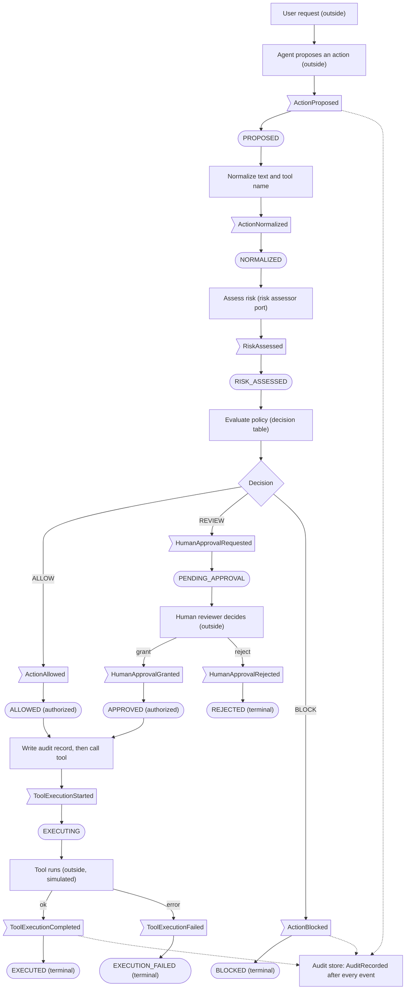

# Process / event flow

Notation used in the diagram (the four kinds are deliberately kept apart):

| Shape | Meaning | Examples |
|---|---|---|
| `>flag]` (asymmetric) | **Event** (a fact, past tense) | ActionProposed, ActionBlocked |
| `[rectangle]` | **Action / activity** (something a component does) | normalize, assess risk, evaluate policy, call tool |
| `([rounded])` | **State** of the AgentAction after the event | NORMALIZED, EXECUTED |
| `{diamond}` | **Decision** point (value `ALLOW` / `REVIEW` / `BLOCK`) | policy decision |

## 1. End-to-end flow

(`AuditRecorded` follows every event, not only the three drawn; the dotted edges are abbreviated for readability. INV-05
requires one record per event.)

## 2. Step-by-step mapping to the required flow

| # | Required step | Kind | Realization | Code |
|---|---|---|---|---|
| 1 | request | outside input | user text reaches the agent | - |
| 2 | proposed action | event | ActionProposed -> PROPOSED | `AgentAction.propose` |
| 3 | normalization | action + event | ActionNormalized -> NORMALIZED | `AgentAction.normalize` |
| 4 | risk evaluation | action + event | RiskAssessed -> RISK_ASSESSED | `RiskAssessor.assess`, `AgentAction.record_risk` |
| 5 | policy evaluation | action (pure function, no event) | `decide(score, effect, policy)` | `policy.decide` |
| 6 | decision | value | `TrustDecision` | `policy.TrustDecision` |
| 7 | ALLOW / REVIEW / BLOCK | event per outcome | ActionAllowed / HumanApprovalRequested / ActionBlocked | `AgentAction.apply_decision` |
| 8 | optional human approval | event | HumanApprovalGranted / Rejected | `TrustGate.approve` / `reject` |
| 9 | execution | action + events | ToolExecutionStarted -> Completed / Failed | `TrustGate.execute` |
| 10 | audit recording | event | AuditRecorded after every event above | `InMemoryAuditStore.append` |

## 3. Verified differences from the A1 workflow

A1: `User request -> AI/LLM receives request -> Trust Gate evaluates risk -> Allow or Block -> if allowed, continues`.
A2 keeps this order for `ALLOW`/`BLOCK`. Added by A2 DESIGN DECISION (not A1 evidence): normalization step, REVIEW branch with
human approval, explicit execution step, audit recording, execution failure. See `a1_baseline.md` section 3.

## 4. Example traces (from the executed walkthrough, `results/raw/walkthrough_scenarios.json`)

See [model_walkthrough.md](model_walkthrough.md) for real traces of each path (ALLOW -> EXECUTED, REVIEW -> APPROVED ->
EXECUTED, REVIEW -> REJECTED, BLOCK).
