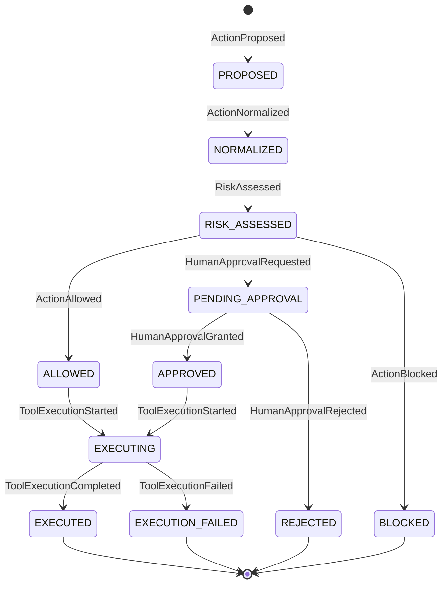

# State model

Central lifecycle entity: `AgentAction` (A1 equivalent: the request that is either passed to the AI system or blocked).
The transition table below is machine-checked against `TRANSITIONS` in `src/trustgate/entities.py` by
`tests/test_model_consistency.py::test_state_model_document_matches_transition_table`.

## 1. States

| State | Meaning | Terminal? | A1 support |
|---|---|---|---|
| PROPOSED | Validated action received, not yet canonicalized | no | A1 (request arrives) |
| NORMALIZED | Text and tool name canonicalized | no | A2 |
| RISK_ASSESSED | Risk score (or its absence) recorded | no | A1 (risk evaluation) |
| ALLOWED | Decision ALLOW; `AUTHORIZED` | no | A1 (Allow) |
| PENDING_APPROVAL | Decision REVIEW; waiting for a reviewer | no | A2 |
| BLOCKED | Decision BLOCK | **yes** | A1 (Block) |
| APPROVED | Reviewer granted; `AUTHORIZED` | no | A2 |
| REJECTED | Reviewer rejected | **yes** | A2 |
| EXECUTING | Tool call in progress (write-ahead audit already written) | no | A1 (request continues) |
| EXECUTED | Tool completed | **yes** | A1 |
| EXECUTION_FAILED | Tool failed | **yes** | A2 |

Terminal states: `BLOCKED`, `REJECTED`, `EXECUTED`, `EXECUTION_FAILED`

Decisions (`ALLOW`/`REVIEW`/`BLOCK`) are **values**, not states. The states they lead to are ALLOWED / PENDING_APPROVAL / BLOCKED.

## 2. Diagram

## 3. Transition table

| ID | Current state | Event | Guard | Next state | Side effect |
|---|---|---|---|---|---|
| T-01 | PROPOSED | ActionNormalized | timestamp not earlier than previous event | NORMALIZED | text/tool name canonicalized; audit |
| T-02 | NORMALIZED | RiskAssessed | score is a `RiskScore` or None | RISK_ASSESSED | score + model version stored; audit |
| T-03 | RISK_ASSESSED | ActionAllowed | decision is ALLOW and derived from the recorded score | ALLOWED | `authorization = AUTHORIZED`; audit |
| T-04 | RISK_ASSESSED | HumanApprovalRequested | decision is REVIEW and derived from the recorded score | PENDING_APPROVAL | ApprovalRequest created (PENDING); audit |
| T-05 | RISK_ASSESSED | ActionBlocked | decision is BLOCK and derived from the recorded score | BLOCKED | audit |
| T-06 | PENDING_APPROVAL | HumanApprovalGranted | reviewer id valid and listed in policy; approval still PENDING | APPROVED | approval GRANTED; `authorization = AUTHORIZED`; audit |
| T-07 | PENDING_APPROVAL | HumanApprovalRejected | reviewer id valid and listed in policy; approval still PENDING | REJECTED | approval REJECTED; audit |
| T-08 | ALLOWED | ToolExecutionStarted | `authorization == AUTHORIZED` | EXECUTING | audit written before the tool is called |
| T-09 | APPROVED | ToolExecutionStarted | `authorization == AUTHORIZED` | EXECUTING | audit written before the tool is called |
| T-10 | EXECUTING | ToolExecutionCompleted | - | EXECUTED | audit |
| T-11 | EXECUTING | ToolExecutionFailed | - | EXECUTION_FAILED | audit |

Every guard failure raises an error and leaves the state unchanged (`ValidationError`, `AuthorizationError` or
`InvalidTransitionError`). Every transition is followed by an invariant check (`assert_invariants`) inside the gate.

## 4. Forbidden transitions (all other (state, event) pairs)

Each of the 11 states x 10 transition events = 110 pairs is tested; the 11 above must succeed, the other 99 must raise
`InvalidTransitionError` and leave the state unchanged
(`tests/test_state_transitions.py::test_every_state_event_pair_is_allowed_iff_in_the_transition_table`). The ones that matter most:

| Forbidden | Why | Test |
|---|---|---|
| BLOCKED -> EXECUTING / EXECUTED (any event) | Invariant INV-01: a blocked action never reaches the tool | `test_block_flow_is_terminal` |
| PENDING_APPROVAL -> EXECUTING | A REVIEW action needs a granted approval (INV-02) | `test_execution_without_approval_is_refused` |
| APPROVED -> HumanApprovalGranted (duplicate approval) | Approval is decided once | `test_duplicate_approval_is_refused` |
| REJECTED -> HumanApprovalGranted (changing a rejection) | Terminal | `test_conflicting_or_repeated_review_decisions_are_refused` |
| NORMALIZED -> any decision event (missing risk result) | A decision needs a recorded risk result | `test_decision_without_risk_assessment_is_refused` |
| EXECUTED / EXECUTION_FAILED -> ToolExecutionStarted (repeat execution) | Execute at most once (INV-06) | `test_repeated_execution_is_refused_and_tool_runs_once` |
| any terminal state -> any event | Terminal means final | `test_no_event_is_accepted_in_a_terminal_state` |
| ALLOWED with `NOT_AUTHORIZED` -> EXECUTING | Execution needs authorization | `test_execution_without_authorization_is_refused_even_in_an_executable_state` |

## 5. Design decisions not stated in A1

| # | Decision | Status |
|---|---|---|
| D-1 | The REVIEW branch (PENDING_APPROVAL, APPROVED, REJECTED) | A2 DESIGN DECISION (motivated by A1-NS; effectiveness unverified, see CX-3, U-02) |
| D-2 | NORMALIZED as a separate state | A2 DESIGN DECISION (small; could be merged into PROPOSED) |
| D-3 | BLOCKED is itself terminal (no separate TERMINATED state) | A2 DESIGN DECISION (simpler than the prompt's candidate) |
| D-4 | EXECUTION_FAILED | A2 DESIGN DECISION (tools outside the boundary can fail) |
| D-5 | No expiry/timeout for PENDING_APPROVAL | Gap (U-02); a pending action can wait forever |
| D-6 | Execution is requested explicitly (`TrustGate.execute`), not automatic after ALLOW | A2 DESIGN DECISION |
